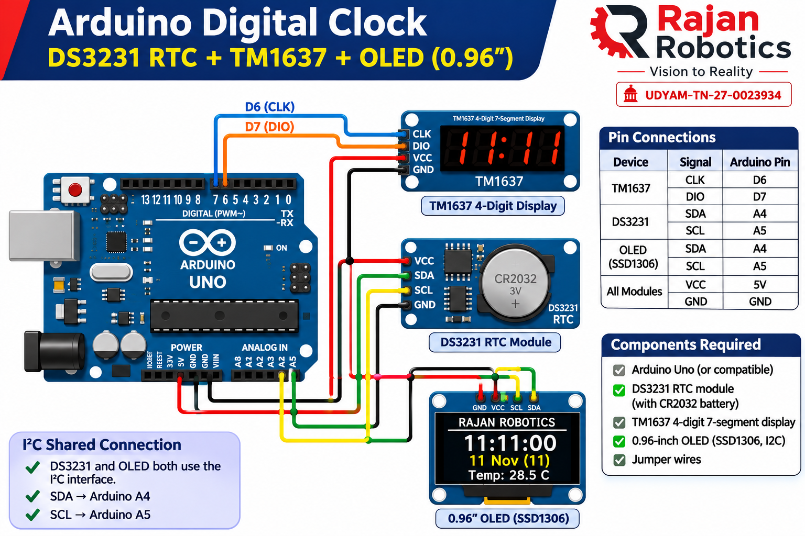
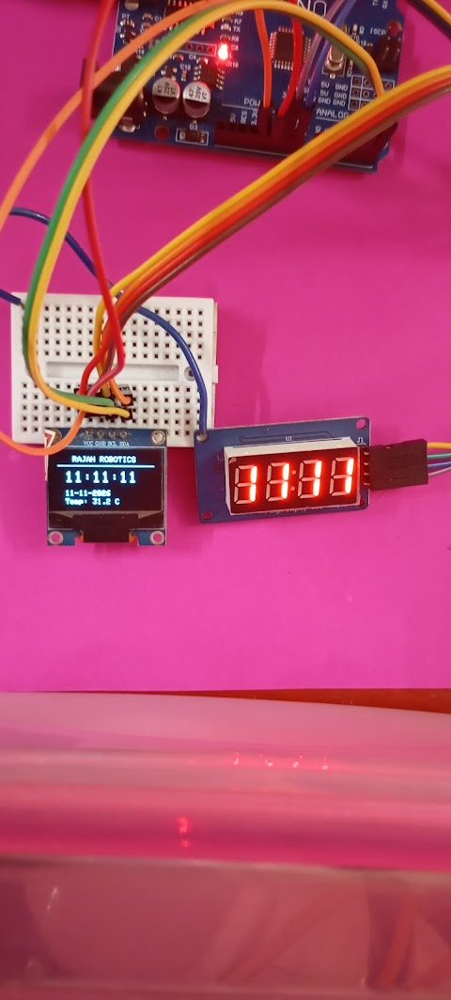

# Arduino Digital Clock using DS3231 RTC, TM1637 and OLED

**Developed by Rajan Robotics**

A real-time digital clock built using Arduino Uno, DS3231 RTC module, TM1637 4-digit 7-segment display and 0.96-inch OLED display.

This project demonstrates RTC interfacing, I2C communication and dual-display interfacing using Arduino.

---

## Project Preview



## Actual Working Prototype

The following photograph shows the actual hardware prototype developed and tested by Rajan Robotics.



---

## Features

- Real-time clock using DS3231 RTC.
- Displays HH:MM on TM1637 4-digit display.
- Displays HH:MM:SS on OLED.
- Blinking colon on 7-segment display.
- Displays current date.
- Displays temperature using the DS3231 sensor.
- RTC battery backup using CR2032.
- Both displays operate simultaneously.
- Shared I2C communication for RTC and OLED.

## Components Required

| S.No | Component | Quantity |
|---|---|---:|
| 1 | Arduino Uno | 1 |
| 2 | DS3231 RTC Module | 1 |
| 3 | TM1637 4-Digit Display | 1 |
| 4 | 0.96-inch OLED SSD1306 (I2C) | 1 |
| 5 | CR2032 Battery | 1 |
| 6 | Breadboard | 1 |
| 7 | Jumper Wires | As required |

## Circuit Connections

### 1. TM1637 4-Digit Display

| TM1637 Pin | Arduino Uno |
|---|---|
| CLK | D6 |
| DIO | D7 |
| VCC | 5V |
| GND | GND |

### 2. DS3231 RTC Module

| DS3231 Pin | Arduino Uno |
|---|---|
| SDA | A4 |
| SCL | A5 |
| VCC | 5V |
| GND | GND |

### 3. OLED Display (SSD1306)

| OLED Pin | Arduino Uno |
|---|---|
| SDA | A4 |
| SCL | A5 |
| VCC | As per module specification |
| GND | GND |

**Important:** DS3231 and OLED share the same I2C bus.

- SDA → A4
- SCL → A5

All modules must share a common GND.

TM1637 VCC should be connected to Arduino 5V, not VIN when powering the Uno through USB.

## Required Arduino Libraries

Install the following libraries using Arduino IDE Library Manager:

1. RTClib by Adafruit
2. TM1637Display by Avishay Orpaz
3. Adafruit GFX Library
4. Adafruit SSD1306

## Software Configuration

1. Install Arduino IDE.
2. Install the required libraries.
3. Connect Arduino Uno to your computer.
4. Select **Arduino Uno** under Tools → Board.
5. Select the appropriate COM port.
6. Open the project `.ino` file.
7. Upload the program.

## RTC Time Configuration

To set the RTC date and time manually for the first time, use:

```cpp
rtc.adjust(DateTime(2026, 11, 11, 11, 11, 0));
```

Change the date and time according to your requirement.

After setting the RTC time, comment out the manual adjustment statement and upload the program again.

The DS3231 maintains the date and time using its CR2032 backup battery when Arduino power is disconnected.

## Expected Display Output

### TM1637 4-Digit Display

```text
11:11
```

### OLED Display

```text
RAJAN ROBOTICS

11:11:00

11 Nov (11)

Temp: 28.5 C
```

*Illustrative display output. Actual time and temperature depend on the RTC.*

## Working Principle

1. DS3231 RTC maintains the current date and time.
2. Arduino communicates with DS3231 through the I2C interface.
3. Arduino reads the current time from the RTC.
4. TM1637 displays hours and minutes.
5. OLED displays hours, minutes, seconds, date and temperature.
6. The TM1637 colon blinks every second.
7. CR2032 battery provides backup power to the RTC when the main power supply is disconnected.

## Project Applications

- Digital clock.
- Embedded systems learning.
- Arduino programming practice.
- RTC interfacing demonstration.
- I2C communication demonstration.
- Practical electronics education.

## Future Improvements

- Alarm clock functionality.
- Buzzer-based alarm.
- Snooze functionality.
- Alarm time configuration using push buttons.
- EEPROM-based alarm storage.
- 12-hour and 24-hour display modes.
- ESP32-based Wi-Fi time synchronization.

## Developer

**RAJAN ROBOTICS**

*Vision to Reality*

Robotics | Embedded Systems | IoT | VLSI | Practical Electronics

**GitHub:** https://github.com/rajanrobotics05-RR

---

If you find this project useful, please ⭐ Star this repository and share it with others!

**Learn • Build • Experiment**
